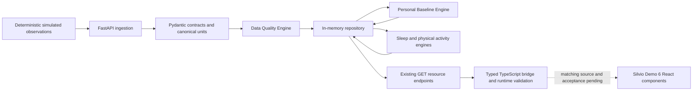

# Technical architecture and implementation status

Assessed branch: `feature/frontend-bridge`, commit `036df20`. This document describes
that checkout, not unmerged work by other contributors. The root README still
describes the original Flutter scaffold; the assessed frontend is React/TypeScript.
No shared README or other owner's files are changed by this task.

## Demonstrated pipeline

The scientific code is pure Python. FastAPI handles request validation and invokes
the domain services; scientific modules do not import the HTTP layer. Pydantic
models are authoritative and exported as JSON Schema. The read-only bridge checks
wire payloads against those contracts and their canonical units. No shared schema
or algorithm change is needed for the intended display mapping.

The current server stores resources in memory. Restarting it erases that instance's
data. There is no demonstrated durable database, authenticated clinical deployment,
live device feed, flight-qualified operation or integrated language-model service.

## Implemented HTTP resources

All paths below are relative to `/api/v1` and are confirmed in
`backend/app/api/routes/monitoring.py` and the health route.

| Method and path                       | Implemented purpose                            |
| ------------------------------------- | ---------------------------------------------- |
| `GET /health`                         | API reachability and service identity          |
| `GET /metrics`                        | Canonical metric definitions and units         |
| `POST /measurements`                  | Batch ingestion and real quality assessment    |
| `GET /crew-members/{id}/measurements` | Stored observations; metric/time/limit filters |
| `POST /crew-members/{id}/baselines`   | Explicit personal-baseline computation         |
| `GET /crew-members/{id}/baselines`    | Stored references; metric/phase filters        |
| `POST /crew-members/{id}/evaluations` | Explicit sleep or physical-activity evaluation |
| `GET /crew-members/{id}/evaluations`  | Stored evaluations; domain/time/limit filters  |

There is no crew directory, mission timeline, single-evaluation GET-by-ID route,
review acknowledgement, annotation, messaging, check-in, sleep-aid schedule or RAG
endpoint. A stored evaluation is selected by its opaque ID from the actual list.
Measurement time filters use an inclusive start and exclusive end; evaluation
filters apply to `window_end`. The application must not assume unsupported routes.

## Status matrix

The labels are independent: an implemented engine can be tested using simulated
inputs while its approved visual integration is still pending.

| Capability                                     | Implemented                         | Evidence                                                            | Simulation/planning boundary                                   |
| ---------------------------------------------- | ----------------------------------- | ------------------------------------------------------------------- | -------------------------------------------------------------- |
| Data Quality Engine                            | Yes                                 | Unit tests, scenarios, actual HTTP ingestion                        | Acquisition settings and device validity remain limited        |
| Personal Baseline Engine                       | Yes                                 | Unit tests, phase-aware scenarios, seeded references                | Establishment criteria in the demo are synthetic               |
| Sleep trends                                   | Yes                                 | Unit tests, replay and stored HTTP results                          | No diagnosis, fatigue prediction or real-world validation      |
| Physical activity                              | Yes                                 | Unit tests, scenarios and HTTP evaluations                          | Targets/rest/completeness are caller-supplied demo context     |
| Mission seeder                                 | Yes                                 | Actual isolated run: 498 measurements, 21 baselines, 13 evaluations | Three simulated crew members only                              |
| Typed FastAPI bridge                           | Yes                                 | Contract, type and isolated HTTP tests                              | Read-only display layer; does not compute scientific outcomes  |
| Existing React HTTP interface                  | Yes                                 | Functional integration tests in the assessed branch                 | Its alternate dashboard fails the approved visual requirement  |
| Approved Demo 6 design                         | HTML reference exists               | Static source/bundle comparison                                     | Matching final React source and visual acceptance pending      |
| Unified Demo 6 mock/HTTP components            | Not yet accepted                    | Acceptance specification prepared                                   | Do not film the current HTTP dashboard as the final UI         |
| Daily Review, messages and sleep-aid workflows | Mock implementation exists          | Original mock tests                                                 | Backend operations unavailable; no delivered report is claimed |
| Vital-sign and cognition evaluation            | Experimental source/prototypes      | Outside the demonstrated sleep/activity HTTP pipeline               | Do not claim live evaluated cards or clinical scores           |
| Nutrition evaluation                           | Not demonstrated                    | Placeholder package in this checkout                                | Planned                                                        |
| NASA observational-data pipeline               | Not integrated in this assessed run | Separate workstream needs owner evidence                            | No dataset-driven result is claimed here                       |
| Separate AI module                             | Not integrated in this assessed run | Owner/contract verification pending                                 | No live RAG or generative guidance claim                       |
| MedGemma 1.5                                   | Separate work by Marco              | Team-confirmed development responsibility                           | Integration, contribution, checkpoint and evaluation pending   |

## Evidence and reproducibility

The [capture script](capture-evidence.mjs) invokes the existing seeder and bridge
against an owned ephemeral FastAPI process. It rejects port 8000, checks seed versus
GET results and saves actual Noor contract payloads. The server settings are explicit
and do not load the main server's `.env`. The
[capture manifest](evidence/capture-manifest.json) records the source commit,
configuration, counts, provenance and payload hashes.

The evidence capture is a reproducible software demonstration. It is not a hardware
acquisition study, a model training run, an astronaut trial or a clinical validation.
The submitted public code/version and links must still be confirmed by the team.
